<p align="center">
  
</p>

<h1 align="center">Risco</h1>

<p align="center">
  <a href="../README.md">English</a> · <a href="README.es.md">Español</a> · <a href="README.gl.md">Galego</a> · Français · <a href="README.pt-BR.md">Português (Brasil)</a> · <a href="README.ja.md">日本語</a> · <a href="README.ko.md">한국어</a> · <a href="README.zh-CN.md">简体中文</a> · <a href="README.tr.md">Türkçe</a> · <a href="README.az.md">Azərbaycanca</a> · <a href="README.hi.md">हिन्दी</a>
</p>

<h3 align="center">Surlignez n’importe quel Markdown. Sans y toucher.</h3>

<p align="center">
  <a href="https://api.reuse.software/info/github.com/CarlosCaoLopez/risco"></a>
  <a href="https://www.bestpractices.dev/projects/0000"></a>
  <a href="https://scorecard.dev/viewer/?uri=github.com/CarlosCaoLopez/risco"></a>
  <a href="../LICENSE"></a>
</p>

<p align="center">
  Libre et open source. Pour Linux, Windows et macOS.
  <br>
  <a href="https://github.com/CarlosCaoLopez/risco/releases/latest">Télécharger&nbsp;&rsaquo;</a>
</p>

<br>

## Installation

Téléchargez l’installateur pour votre système depuis la
[dernière version](https://github.com/CarlosCaoLopez/risco/releases/latest) :

| | |
|:--|:--|
| **macOS** | Ouvrez le `.dmg` et glissez Risco dans Applications. |
| **Windows** | Lancez le `-setup.exe`. |
| **Linux** | Installez le `.deb` ou le `.rpm`, ou lancez l’`.AppImage`. |

Ou installez-le avec Homebrew :

```sh
brew install --cask CarlosCaoLopez/tap/risco
```

Risco est signé avec un Developer ID et notarié par Apple : il s’ouvre comme
n’importe quelle autre app. Au premier lancement, macOS demande l’accès
Accessibilité, dont Risco a besoin pour voir le geste. Windows peut afficher un
avertissement SmartScreen, car l’installateur n’est pas encore signé : choisissez
*Informations complémentaires › Exécuter quand même*.

C’est tout. Risco vit dans la barre des tâches, démarre avec votre ordinateur et
installe tout seul son plugin dans chaque coffre Obsidian et dans VS Code.

<br>

## Maintenez. Glissez. Surligné.

Maintenez <kbd>Ctrl</kbd> (<kbd>⌥</kbd> sur macOS) et glissez sur n’importe quel
texte dans le mode lecture d’Obsidian, l’aperçu de VS Code ou Orca. On dirait un
vrai surligneur, et le surlignage reste.

<!-- demo.gif -->

<br>

## D’abord, la lecture.

Les surlignages vivent sur la page rendue : passez-y avant de glisser.

| | |
|:--|:--|
| **Obsidian** | Mode lecture : <kbd>Ctrl</kbd>&thinsp;<kbd>E</kbd> (<kbd>⌘</kbd>&thinsp;<kbd>E</kbd>), ou l’icône du livre en haut à droite de la note. |
| **VS Code** | Aperçu Markdown : <kbd>Ctrl</kbd>&thinsp;<kbd>Shift</kbd>&thinsp;<kbd>V</kbd> (<kbd>⇧</kbd>&thinsp;<kbd>⌘</kbd>&thinsp;<kbd>V</kbd>), ou <kbd>Ctrl</kbd>&thinsp;<kbd>K</kbd> <kbd>V</kbd> pour l’ouvrir à côté de l’éditeur. Cliquez dans l’aperçu, puis glissez. |
| **Orca** | Rien à changer : surlignez directement dans l’éditeur. |

Dans le mode édition d’Obsidian ou dans l’éditeur de VS Code, le geste ne fait rien.

<br>

## Un geste pour tout.

| | |
|:--|:--|
| <kbd>Ctrl</kbd> + glisser | Le surligner. |
| <kbd>Ctrl</kbd> + glisser sur un surlignage | L’enlever. |
| <kbd>Ctrl</kbd>&thinsp;<kbd>Alt</kbd>&thinsp;<kbd>1</kbd>–<kbd>5</kbd> | Jaune, rose, vert, bleu ou lilas. |
| *Annuler le dernier* dans la barre des tâches | Annuler le dernier. |

<br>

## Votre Markdown. Intact.

Les surlignages vivent dans un fichier caché à côté de chaque note, pas dans la
note elle-même. Le plugin Obsidian et l’extension VS Code les affichent en place.

Orca ne peut pas charger de plugins : là, le surlignage va dans la note sous la
forme `++texte++`, le seul balisage qu’il affiche.

Si l’éditeur a des modifications non enregistrées, rien n’est écrit.

<br>

## Privé par conception.

Pas de compte. Pas de réseau. Pas de statistiques.
Risco tourne entièrement sur votre ordinateur, et vos notes n’en sortent jamais.

<br>

## Caractéristiques

| | |
|:--|:--|
| **Plateformes** | Linux (X11), Windows, macOS |
| **Visionneuses** | Obsidian, VS Code, Orca |
| **Conçu avec** | Rust, Tauri 2 et TypeScript |
| **Accès réseau** | Aucun |
| **Prix** | Gratuit |

<br>

## Compiler depuis les sources

```sh
npm install
npm run tauri build
```

Sous Linux, il vous faut aussi les paquets habituels de Tauri/WebKitGTK,
`libxtst` et une bibliothèque appindicator.

L’app installe elle-même les plugins des visionneuses au premier lancement.

<br>

## Licence

Risco est un logiciel libre sous [GNU General Public License v3.0 ou ultérieure](../LICENSE), distribué **sans aucune garantie**. Pour contribuer, lisez [CONTRIBUTING.md](../CONTRIBUTING.md) (en anglais) ; les problèmes de sécurité se signalent en privé selon [SECURITY.md](../SECURITY.md).
